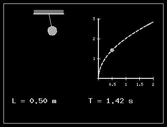
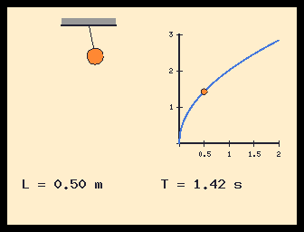
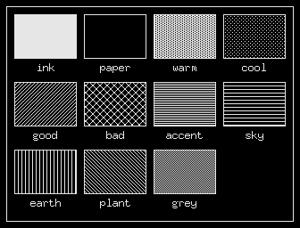
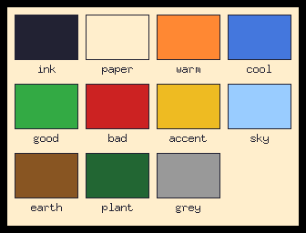
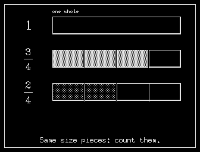
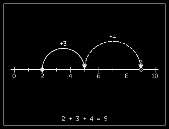
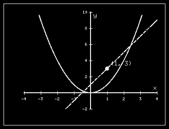
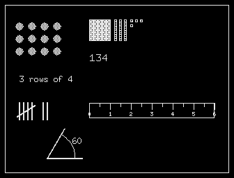

# learn: figures

A step in a lesson can have a **figure**: a picture that learn draws
while the learner reads. Figures are Scheme in ```` ```figure ````
blocks. They can be changed with controls (sliders, toggles, choices,
points to drag) and can move. One figure source draws three ways:

- on one bit, with a pattern for each colour;
- in the colour window, with real colours;
- on paper (later, through zpaper).

This page is the figure vocabulary, the library and how figures run.
The course format is [learn_format.md](learn_format.md), and the design
is [learn.md](learn.md).

```figure
(define L (slider 'length 0.1 2.0 0.5 "Length (m)" 0.05))
(define T (* 2 pi (sqrt (/ L 9.81))))
(define a (* 12 (cos (* 2 pi (/ (seconds) T)))))
(define bx (+ 90 (* 70 L (sin (deg->rad a)))))
(define by (+ 20 (* 70 L (cos (deg->rad a)))))
(line 90 20 bx by 'ink 1.2)
(circle bx by 9 'warm)
(graph 190 30 110 120 0 2 0 3)
(graph-axes 0.5 1)
(plot (lambda (l) (* 2 pi (sqrt (/ l 9.81)))) 'cool)
(plot-point L T 'warm)
(text 16 200 (string-append "T = " (fmt T 2) " s") 'body 'bold)
```

This is a pendulum. Its period follows the slider, and the bob swings
with that period. The point on the graph of T against L is where the
slider is.

 

## How a figure runs

- **Units.** A figure draws in its own **320 x 240 units**, with x to the
  right and y **down**, the same as the screen face. Learn scales the
  units to fit the pane: 1:1 beside the words in a full window, smaller
  above them in a narrow one.
- **One picture per step.** All the figure blocks of a step are joined
  and draw in that step's one pane.
- **Run whole, every frame.** Every time a figure is drawn, its blocks
  run from the top. What they draw goes into a display list, and the
  list is put on the page. Nothing carries over from one frame to the
  next except:
  - the controls' values;
  - the time, `(seconds)`.

  So a frame depends only on those two. That makes every frame
  checkable (see [Checks](#checks)) and lets learn draw it again at any
  time: after a resize, on a reflow, or in colour.
- **Definitions stay inside the figure.** A figure's `define`s belong to
  it. The next figure starts without them. Learn does this by running
  each figure inside a closure.
- **Course libraries.** A course's own procedures go in **`lib/*.scm`**
  in its folder, and a pack's shared ones in `lib/*.scm` in the pack's
  folder. Each is joined in name order; the pack's come first, then the
  course's, before every figure of that course and only that course.
  A figure gets only the library's top-level forms it uses: a
  `(define NAME ...)` whose NAME the figure (or a form so taken) uses,
  and every form that defines nothing. Every definition costs cells of
  the figure's heap, and Timeless Computing's six authors' libraries
  together once ran every figure out of it (`lib_needed()` in lfig.c).
  Together a course's libraries may be 24 KB.
- **Slow frames are stopped.** A frame that runs longer than 0.6 s is
  stopped. The pane then says "the figure took too long to draw", and
  the window keeps answering throughout.

## Drawing

Every number is in units. The optional words after the numbers can come
in any order:

- a **colour role**: `'warm`;
- an **alignment**: `'left`, `'centre` (or `'center`), `'right`;
- a **size**: `'tiny`, `'small`, `'body`, `'big`, or a number of units
  for a serif face;
- **`'bold`**;
- one **width** (a number), for lines.

| Form | Draws |
|---|---|
| `(line x0 y0 x1 y1 [role] [width])` | a line (width 1.5 by default) |
| `(arrow x0 y0 x1 y1 [role] [width])` | a line with a head at its end |
| `(rect x y w h [role])` | a filled rectangle (ink by default) |
| `(frame x y w h [role] [width])` | a rectangle's outline, inside its box |
| `(circle cx cy r [role])` | a filled disc |
| `(ring cx cy r [role] [width])` | a circle's outline |
| `(dot x y [role])` | a small disc, radius 2.5 |
| `(arc cx cy r from to [role] [width])` | part of a circle; degrees, 0 to the right, counter-clockwise |
| `(poly '(x0 y0 x1 y1 ...) [role])` | a filled polygon |
| `(path '(x0 y0 x1 y1 ...) [role] [width])` | an open line through the points |
| `(text x y words [role] [size] [align] [bold])` | words with their baseline at y; a number is written as words (2.5, 4) |
| `(math x y "3/4" [size] [role] [align])` | a formula typeset as in lessons ([learn_format.md](learn_format.md#formulas)); centred by default, 20 units |

The sizes are:

- `'tiny`: 5x8;
- `'small`: 7x13 (the default);
- `'body`: 9x15;
- `'big`: 10x20;
- a number: Hershey serif at that size in units, scaled with the figure.

## Colours

Figures name colours by **role**, never by value. Each role has a
pattern for one bit and a colour for the colour window and the screen
face. So a figure is right in both without being written twice.

| Role | One bit: a fill | One bit: a line | Colour |
|---|---|---|---|
| `ink` | solid | solid | dark ink |
| `paper` | the ground (erases) | the ground | cream |
| `warm` | dense dots | solid | orange |
| `cool` | sparse dots | dashes | blue |
| `good` | rising lines | dots | green |
| `bad` | crosses | dash-dot | red |
| `accent` | stripes | short dashes | yellow |
| `sky` | fine stripes | long dash-dot | light blue |
| `earth` | upright lines | long dashes | brown |
| `plant` | falling lines | dash-dot-dot | deep green |
| `grey` | half | dots, close | grey |

 

On one bit, a line in ink drawn over a dense fill cannot be seen. Draw
a cut through a filled piece with a `'paper` line under it, as
`frac-bar` does. Use two or three roles in a figure, not more.

On a board with **two** colour-window planes there are 8 colours: sky
shows as cool, plant as good, and grey as earth.

**Black and white is the rule.** A figure is drawn on one bit, with the
patterns above, unless it says **`(colour)`** (or `(color)`): a figure
whose colours must be seen to be read -- a map, a colour wheel, a chart
whose key is its colours. Only such a figure takes the colour window
("Colour", below). Colour costs: the planes are drawn as well as the
page on every change, the desktop gives up its tints, and the mouse
pointer is hard to see over it. The same figure without `(colour)` reads
the same with patterns.

```figure
(colour)
(frac-bar 0 4 3 'warm "3/4")
```

## Controls

A control is asked for by name and returns its value. Asking for it in
the next frame returns the value the learner gave it. Learn draws each
control on a row under the figure, with its label. At most 6 controls
per figure.

| Form | Is | Returns |
|---|---|---|
| `(slider 'name min max [start] ["label"] [step])` | a slider | its value (on its steps, if given) |
| `(toggle 'name ["label"] [#t])` | a box to tick | `#t` or `#f` |
| `(choice 'name '("a" "b" "c") ["label"])` | buttons, one chosen | the index chosen, from 0 |
| `(drag 'name x y [r])` | a point the learner can drag (a ring shows it) | `(x y)`, where it is now |

The learner can change controls in three ways:

- **Mouse:** drag a slider, click a toggle or a choice, drag a point.
- **Left and Right:** change the selected control. **C** selects the
  next one.
- **While a typed answer is empty**, Left and Right go to the figure, so
  a question about the slider can be answered with it.

## Time

`(seconds)` returns the seconds since the step was shown. Asking for it
makes the figure **move**. learn draws it again up to a dozen times a
second, but never spends more than a third of its time on it, so the
window keeps answering. Only the figure is drawn, and only that part
goes to the screen. **P** pauses and starts it, and the frame stops
where it was.

**`(still forms...)`** draws the parts that do not move. The forms run
once, and again only when a control changes. What they draw stays at the
front of the figure's list; once it has been drawn, its pixels are read
back from the screen and each frame after starts with one copy of them
(a blitter operation). The frames after that run only what moves:

```figure
(still (clock-dial 160 120 100))
(clock-ticking 160 120 100 3 0)
```

On the board this matters. A clock face is 60 ticks and 12 numbers,
each placed with sin and cos, which are soft-float there: about 1.5
million instructions to run on the board's CPU. With `still` around the
face, a frame is the hands alone: about 66,000 instructions, and a copy
and a few lines for the hardware. `still` must come first in a figure;
anywhere else, its forms simply run every frame.

A frame is stopped after 0.8 s when the figure moves, and after 5 s when
it is drawing its still part (the first frame, or one after a control
changed). A moving figure that is stopped is paused and says so: "this
figure moves too slowly on this computer (P to try again)".

## Numbers and words

The figure has Machdyne Scheme's numbers and lists ([scheme.md](scheme.md)),
plus:

- `sin cos tan asin acos atan exp log`, all in radians;
  `(atan y x)` is the two-argument form;
- `pi`, `deg->rad`, `rad->deg`;
- `(lerp a b t)` and `(clamp x lo hi)`;
- `(for-range a b f)`, which calls `f` on a, a+1, ... b-1;
- `(fmt x digits)`, which formats a number with that many digits after
  the point, never "-0".

## The library

These procedures are built into learn (`sw/apps/learn/figlib.scm`) and
tested once (`make -C sw/apps/learn test` draws every one).

| Procedure | Draws |
|---|---|
| `(frac-bar row parts shaded role ["3/4"])` | rows of equal bars, 56 units apart, with a fraction typeset beside each |
| `(frac-bar-at x y w h parts shaded role)` | one bar anywhere |
| `(frac-circle cx cy r parts shaded role)` | a circle cut into parts from the top, clockwise |
| `(number-line x0 x1 y from to [tick] [label-every])` | a number line |
| `(nl-x v)`, `(nl-y)` | where a value is on the last number line |
| `(nl-mark v role ["label"])` | a point on it |
| `(nl-jump a b role ["+3"])` | a hop from a to b, over the line |
| `(graph left top w h xmin xmax ymin ymax)` | sets up a graph (draws nothing) |
| `(gx x)`, `(gy y)` | a graph's values in units |
| `(graph-axes xstep ystep ["x" "y"])` | axes through 0 (or along the edges), with ticks and numbers |
| `(plot f role [width])` | y = (f x) across the graph, broken where it leaves it |
| `(plot-point x y role ["label"])` | a point on the graph |
| `(bar-chart '(("Mon" 3) ...) role [top])` | a bar chart |
| `(dot-array x y rows cols gap role)` | dots in rows and columns |
| `(grid x y cols rows size [role])` | squares |
| `(base-ten x y hundreds tens ones)` | place-value blocks |
| `(ruler x y len px [label-every])` | a ruler, half marks included |
| `(tally x y n)` | tally marks in fives |
| `(clock-face cx cy r h m)` | an analogue clock: `(clock-dial cx cy r)` and `(clock-hands cx cy r h m [s])`, which a moving clock draws apart, the dial in `still`; with `s`, a thin second hand |
| `(clock-ticking cx cy r h m)` | a clock keeping time from h:m:00 when the step is shown, its second hand ticking once a second (under a `still` dial) |
| `(angle-mark cx cy r from to ["60"])` | an angle's arc and label |
| `(arc-points cx cy r from to)`, `(wedge cx cy r from to role)` | arcs as points, a pie slice |
| `(label x y "words")`, `(caption "words")` | centred words; a line at the foot of the figure |

   

The library keeps a graph's and a number line's scale in globals that
`graph` and `number-line` set. A `plot` costs about 80 evaluations a
point, so a figure with a graph runs about 7,000 evaluations a frame.
On the board that is fine for a figure that only changes with its
controls, and about the most a moving one should do.

## The sandbox

A figure runs in Machdyne Scheme ([sw/ext/ms](scheme.md)) **without the
Zeitlos API** (`zapi_register()` is never called). It is built with `LIX`,
which compiles out `load` and `file->str`. `exit`, `read` and `dump` are
replaced with procedures that only say "a figure cannot do that".

A figure from a course pack can draw, compute and move. It cannot read
or write files, reach the network, run programs or see the learner's
records. `make test` tries each of these.

The interpreter has a static heap of 20,000 cells (about 5,300 live once the library is loaded, the rest so that a frame seldom collects). A figure that draws
more than 1,200 shapes, or writes more than 6 KB of words, is a
mistake: the pane says so, and so does learncheck.

**Changes to Machdyne Scheme came with this**, in
`tools/learn/ms-learn.patch` and still to be committed to machdyne/ms.
ms's own tests pass with them. The latest: a second `ms_init()` frees
the strings of the cells in use, so learn can start Scheme afresh. It
does, for the next figure, after one ran the heap or the protect stack
out (before, every figure after it failed the same way) and after every
16 figures (symbols are never freed while it runs).

- **A fix.** `ms_eval()` did not protect a new environment while the
  body of a `let`, `let*`, named `let`, `letrec` or procedure call ran.
  A garbage collection during that time could free the caller's
  environment. This happens when a global procedure (such as the
  library's) is called from inside a closure (such as a figure), and
  the caller's next name lookup then failed as "unbound". The fix is
  five lines, each storing the new environment in its frame's protected
  slot. slide's and repl's scripts had the same exposure.
- **Speed.** Interning a symbol and looking up a global were walks along
  lists of every symbol and every global, several hundred long with
  the library loaded, and the top of the profile. Two tables of 2,048
  pointers each (16 KB) now find both directly. If a table fills, the
  lists are walked as before.

## Speed

A key press must show at once. learn draws the way the rest of the
system does: straight into its window with the graphics hardware
([gpu_blitter.md](gpu_blitter.md)), and as little as it can.

**Drawing** goes through a device (`ldraw.h`). On the board each call
is one operation of the blitter or the line rasterizer, confined by
them to the window's visible region (learn.c):

| learn draws | the hardware does |
|---|---|
| a rectangle, a frame, a rule | a fill (`z_fb_hw_fill_rect`) |
| a shade, a colour's pattern | a dithered or 8x8-pattern fill |
| a thin line, a ring, an arc | rasterizer lines (`z_fb_hw_line`) |
| a thick line (up to 6 px) | a few rasterizer lines side by side |
| a disc, a rounded box, a polygon | its rows worked out by the CPU (integers), each run of equal rows one fill |
| a figure | drawn in memory (its own bitmap, kept), the part that changed copied in one blit: never seen half drawn |
| a line of text | its glyphs put side by side in a strip by the CPU, then one copy (`z_fb_hw_blit_mem`, OR or AND-NOT) |
| a scroll | `z_fb_hw_scroll`, then the band it uncovers |
| a moving figure's still part | one copy of its pixels, kept from its first frame (each colour plane too) |

Each glyph is drawn once into a glyph cache (a bitmap face's rows as
they are; a Hershey face, any size, as zcanvas draws it) and copied
from there; the faces are the same as before, so nothing is lost and
glyph memory (the blitter's own glyph mode, 8 pixels wide at most) is
not needed. Nothing is drawn into a page in memory and copied after. A
board whose blitter has no raster ops draws into a page in memory with
the same operations in software (ld_soft) and copies it, as the tests
do.

**As little as it can:**

- **Typing in an answer** draws only the field.
- **A figure's control** draws only the figure and its controls, over
  what is there (nothing is cleared first). The controls are drawn in
  memory and copied in one go, before the figure is run again, so the
  slider moves at once. A control set to the value it has (a slider let
  go where it is, Right at its end) draws nothing.
- **Only what changed is drawn again.** After a frame or a control,
  each shape is compared with the one in its place before (a hash of
  all it is): the figure is drawn again, in memory, only inside the box
  of the shapes that changed -- where they were and where they are --
  and only that box is copied to the screen. A corner of a triangle
  dragged redraws around the triangle, not the label above it; a frame
  that draws what the frame before drew (a clock between two ticks)
  draws nothing. Several mouse moves that arrive together are one
  figure-only redraw, never the page's part around it.
- **A moving figure's frame** draws only where its moving shapes were
  and are: the still shapes under them are copied back from their
  bitmap and the moving ones drawn over them. Each colour plane the
  same, piece by piece where the fold splits it.
- **A scroll** moves the view's pixels (the blitter) and draws only the
  band it uncovers.
- **The step's layout is kept**: where each block starts and ends, and
  the targets it makes. A part of the page lays out only the blocks
  that cross it; the whole page only those in view.
- **A step's words come first**: a step with a figure is drawn with
  "drawing the figure ..." in the pane, and the figure is read and run
  just after (`la_figure_now()`), so the words show at once.
- **A press shows at once**: the button or key turns over (an XOR fill)
  before the work it starts.
- **The title** is sent to wm only when it changes.

`tests/render.c` checks that each kind of partial draw leaves exactly
the page a whole drawing makes, and draws every screen through the
software device. `tools/learn/rvbench` builds learn for the board's
CPU (rv32im, learn's own flags) and runs it in an emulator that counts
the instructions of each kind of key press, with a model of the
board's caches; the page is a stand-in for the GPU device (each
operation a few register writes). Instructions on the board's CPU,
before (r8: zcanvas into a page, copied) and now:

| Each | r8 | Now |
|---|---|---|
| key typed in an answer | 195,000 | 20,000 |
| step of a slider (the figure runs again) | 1,050,000 | 340,000 (half of it the figure's Scheme) |
| frame of the moving clock | 277,000 | 69,000 (the hands' box redrawn) |
| notch scrolled | 680,000 (the view) | 74,000 |
| a step's page, drawn whole | 1,200,000 | 510,000 |
| the clock's step opened (Scheme, the face) | 5,200,000 | 3,400,000, after its words are up |

On the board, a repaint slower than 40 ms prints a line on the console
("learn: part 322x274: drawn 55 ms, then 3 ms"), so a slow screen can
be found.

## Colour

On a board with the colour window ([color.md](color.md#the-colour-window)),
a figure that asks for colour (`(colour)`, "Colours" above) and shows
whole is drawn in colour:

1. learn's window is created with `Z_WIN_FLAG_COLOR | Z_WIN_FLAG_COLOUR_LATER`.
2. While the lesson's step has such a figure, learn tells wm it wants the
   colour window (`Z_WM_COLOR_WANT 1`). This holds even when the figure
   is scrolled out of view, so that scrolling does not pass the sheet
   back and forth with desktop colour. On a step without a figure it
   says it no longer does.
3. When wm hands the window over (`Z_WM_COLOR 1`, which makes learn
   draw again) and the figure is wholly on screen with nothing over it,
   learn sets COLWIN over the figure's 320 x 240:
   - the page's pixels there are each colour's lowest bit;
   - the other 2 or 4 bits are the window's planes, drawn from the
     same display list (`lg_render_plane()`) by the blitter and the
     rasterizer straight into the second VRAM sheet, piece by piece
     where the fold splits a plane.

   The planes are drawn with the window's region cleared from the
   scissor (`z_gfx_clear_visible()`), because the second sheet is
   outside every window's rectangles. Under the region, the drawing was
   cut away, and the board showed whatever the sheet held before: the
   first board test's "white with a blue bar".
4. A control that changes the figure writes the planes again; a frame
   of a moving one writes only where its moving shapes were and are.
   The colour window taken or given back (F10, a scroll that puts the
   figure partly out of view) draws the figure alone again, not the
   page; a scroll that only moves it draws the planes where it now is
   (the page's part moved with the page).
5. **F10** turns the colour off and on in learn, as in screen apps.

**What this costs on the 45F boards:** desktop colour's tints, while a
figure is in colour and learn has the focus. wm takes them back as it
does for any colour window. [app_kinds.md](app_kinds.md) describes this
as the one place a desktop face shows colour.


## Checks

`learncheck` ([learn_format.md](learn_format.md#checks)) runs every step's
figure as learn runs it, with the course's `lib/*.scm`. It runs these
frames:

- the first frame;
- a moving figure at 0.37, 1, 2.9, 7.5, 13.1 and 61 seconds;
- every slider at its minimum and maximum;
- every toggle off and on;
- every choice at each option;
- every point dragged to each corner and to the middle;
- all the points in one place.

Any error is reported with the line of the figure and what showed it:

```
lesson.md:21: error: figure, with n at 0: /: division by zero
lesson.md:39: error: figure, at 7.50 seconds: line needs 4 numbers first
lesson.md:47: error: figure, with every point in one place: /: division by zero
lesson.md:31: warning: figure: it draws outside its 320 x 240
```

A position that is not a number (a division by zero that became
infinity) is an error. A frame that takes more than 60 ms on the build
machine is a warning, since it will be slow on the board.
`tests/courses/t-figs` is a course of broken figures that the test target
expects each of these from.

## Files

| File | Is |
|---|---|
| `sw/apps/learn/lfig.c`, `lfig.h` | the runtime: the builtins, the display list, controls, drawing (one bit, a plane) |
| `sw/apps/learn/ldraw.c`, `ldraw.h` | drawing through a device: shapes as fills and lines, text through the glyph cache, the software device |
| `sw/apps/learn/learn.c` | the board's device: the blitter and the rasterizer |
| `tools/learn/rvbench/` | learn on the board's CPU in an emulator: instructions and a cycle model for each kind of key press |
| `sw/apps/learn/figlib.scm` | the library (made into `figlib.h` by the Makefile, comments dropped) |
| `sw/apps/learn/tests/test_fig.c` | the sandbox, the list, controls, time, mistakes, and pictures of the library (`tests/out/fig-*`) |
| `tools/learn/learncheck/learncheck.c` | runs figures for the checks above |
