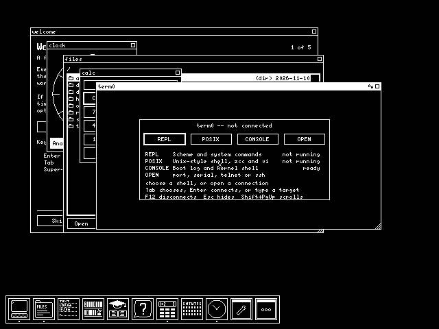
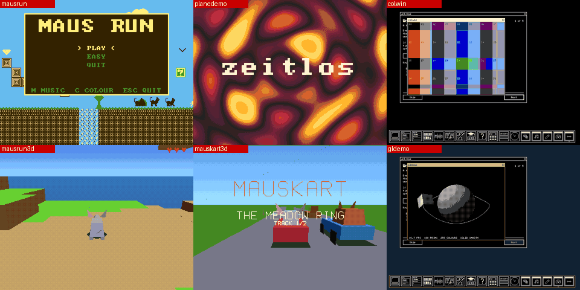

# zsys: the SoC, emulated

`sim/sys/`: the Zeitlos SoC on a host -- the real BIOS, kernel, drivers
and apps, the binaries a release flashes. The plan it follows, and the
milestones still to come, are in [sim_parity.md](sim_parity.md).

**Status: milestones 3 and 4 -- usable, on a PC and in a browser.** A
Lakritz without its USB host boots the release's BIOS, kernel and core
apps; with a release's card image in the slot `fs` mounts it, `wm`
draws the desktop on the emulated GPU -- the blitter, the line
rasterizer, glyph memory, the hardware cursor -- and `welcome` greets
a new card, or a machine with no card. A keyboard and a mouse on the
USB ports, the flash's write path for the key/value store, a window
(SDL2) and a page (WebAssembly, `sim/sys/web`, "In a browser" below).

```
$ make -C sim/sys
$ RISCV_PREFIX=... release/zrelease sim         images/zeitlos-sim.img, from the built tree
$ sim/sys/zsys --flash images/zeitlos-sim.img --sd zeitlos.img --window
```

**The window** is the board's screen at twice its size (`--scale`),
the host's keyboard is the USB keyboard and its mouse the USB mouse.
**Ctrl+Alt+Enter** puts it full screen and back (`--fullscreen` starts
that way); F11 stays Zeitlos's own, for its full-screen apps. Close
it to stop. Without `--window`, `zsys` is headless: the console
is UART0 on the terminal -- what the machine prints comes out there,
and what is typed goes to the kernel's shell, which can start apps
(`run /apps/files`) -- and **Ctrl+]** leaves. Either way
`--screenshot` writes the screen as it was at the end.

```
$ sim/sys/zsys --flash images/zeitlos-sim.img --sd zeitlos.img --fast --seconds 4 \
      --after "firstrun removed" --keys '\t\n' --click 64,450 --screenshot desk.png
...
wm: a new card (/sys/firstrun) -- starting welcome
welcome: a card -- /sys/firstrun removed
wm: win 2 'read' pid 5 at 68,60 320x300
wm: dock: launched 'files' as pid 6
```



*Started from the console, as above, with `--clock` and `--cursor`.*

`sim/` itself is unchanged: its single-app emulator (`machine.c`, with
`simos.c` standing in for the kernel) still runs one app fast, for the
tests that use it ([sim/README.md](../sim/README.md)).

## Images

| image | where the BIOS comes from |
|---|---|
| `zeitlos-sim.img`, from a release or `zrelease sim` | inside it: the gateware region holds `ZSIMBIOS`, the BIOS's length and the BIOS, and the rest is the flash layout every target has (kernel, core apps, key/value store) |
| a release's `zeitlos-<board>.img` | `--bios FILE`: the image's gateware region is ignored -- the emulator has no use for a bitstream, and its BIOS is inside the bitstream's BRAM |

`zrelease sim` takes the newest `output/<board>/apps.zar`, says which
and what is in it, and refuses one that lacks an app of the Makefile's
`CORE_APPS` -- an archive older than the tree, which would boot without
`welcome`.

The sim image's BIOS is the Lakritz one (`sw/bios`, `BOARD=LAKRITZ`),
since the emulated board is a Lakritz. A page that runs Zeitlos sends a
visitor the sim image, and no gateware. `sim/sys/mksimimg.py` builds
it, with the offsets `release/lib/layout.py` reads from the tree.

## The CPU

Zeitlos32 (`rtl/cpu/zeitlos32/zeitlos32.v`), instruction by
instruction, with zeitlos32p's IRQ timer, which the kernel needs:

- RV32IM, `fence` as a nop, the counter CSRs (`rdcycle`, `rdinstret`
  and their high halves) and no others;
- picorv32's interrupt ABI: `getq`, `setq`, `retirq`, `maskirq`,
  `waitirq`, `timer`, the four q registers, the vector at `0x10`,
  `irq_mask` all ones at reset, `LATCHED_IRQ` as `rtl/sysctl.v` sets it
  (everything latched but the UART, IRQ 4, audio, IRQ 7, and the USB host,
  IRQ 9, which are levels);
- an interrupt is taken at an instruction boundary when
  `pending & ~mask` is non-zero and the core is not in a handler, and
  never in the instruction after `retirq`; delivery clears what it
  delivered;
- `waitirq` reports the pending set without clearing it; stalled, it
  takes no interrupt, and returns as soon as anything pends;
- an illegal instruction, `ecall`, `ebreak` or a misaligned access is
  retired without running and pends IRQ 1 or 2 -- or, with that line
  masked or the core in a handler, halts it (`zsys` says where and why).

**The core's own test programs pass on it:** `t_alu`, `t_branch`,
`t_mem`, `t_muldiv`, `t_csr`, `t_irq` and `t_illegal`
(`rtl/cpu/zeitlos32/tests/prog`), `t_timer` and `t_hazard`
(zeitlos32p's) -- the same programs `tb_zeitlos32.v` runs against the
RTL, in a machine with the same test port and IRQ ports
(`zsys --tb prog.bin`).

## Time

Each instruction costs 2 of the board's 48MHz clocks (`--cpi`). The
tick (IRQ 3, every 65,536 clocks: 732 a second), the IRQ timer and
`rdcycle` all count these, so they agree with each other as on the
board. Zeitlos32 takes about 5 clocks an instruction (906 cycles for
`t_alu`'s 181, [zeitlos32.md](zeitlos32.md)), so the emulated board is
quicker than a real one, never slower.

`zsys` keeps to the board's pace -- a second of the machine's time
takes a second -- unless `--fast`. A stalled `waitirq` skips straight
to the next tick or timer expiry, so an idle machine is idle on the
host too.

## The board

What the CSRs say this board has ([csrs.md](csrs.md)): `MEM_SDRAM`,
`MEM_VRAM`, `MEM_ROM`, `MEM_GLYPH`, `GPU`, `GPU_RASTER`, `GPU_BLIT`,
`GPU_CURSOR`, `UART0`, `USB_HID`, `SPI_SDCARD`, `CPU_MUL`, `CPU_DIV`,
`CPU_ZEITLOS32`, `RTC`, `AUDIO`, `GAME`, and in `FEATURES2` `RECONFIG`,
`FLASHW` and `COLOR`; 32MB. That is a Lakritz (`rtl/boards.vh`) with
the HID-only USB of the older gateware in place of its USB host, and
**the video of a 45F board** (Mozart ML1/ML2): eight colour planes,
chunky, the colour window and desktop colour, where Lakritz has six
planes and neither -- so every program that has colour shows it -- and
**T2**, as sergei_ml2's build has it. Still to come: DDMI, the caches
(which change only speed). The kernel and apps check
these bits before touching a device, so what is missing is left alone.

`--headless` is milestone 1's board instead -- memory, the flash, UART0
-- which runs as Klinge does: `init` does not start `wm`.

| address | device | |
|---|---|---|
| `0x0000_0000` | BRAM, 8KB: the BIOS | mirrored through its select |
| `0x1000_0000` | the flash window | read-only; past the image reads `0xFF` |
| `0x2000_0000` | VRAM, 128KB (the port's 17 address bits) | the desktop is the first 38,400 bytes |
| `0x3000_0000` | glyph memory, 4KB | the font the blitter's glyph mode draws from |
| `0x4000_0000` | main memory | `--ram`, 32MB by default |
| `0x7000_0000` | the CSRs | magic, `MEM_MB`, `FEATURES` 1-3, `FLASH_BASE` |
| `0x7000_0200` | socctl (`rtl/socctl.v`) | the cursor's slots and shapes, the phosphor and its brightness, the frame counter and vertical blank (59.94Hz from the machine's clock), RECONFIG; the rest answers with its signature and "not available" |
| `0x7000_0300` | the RTC (`rtl/rtc.v`) | from 0 and not valid at power-on, as on the board; `--clock` starts it at the host's time, valid |
| `0x7000_0500` | audio (`rtl/audio.v`, `rtl/audio_mixer.v`) | the FIFO, the eight-channel mixer, the sample clock, the system volume: below |
| `0x8000_0000` | an app's window | through the MTU |
| `0x9000_0000` | the MTU | its translation base |
| `0xa000_0000` | the line rasterizer (`rtl/gpu/gpu_raster.v`) | |
| `0x1F00_0000` | the flash's registers (`rtl/spiflash.v`) | erase a 4KB sector, program a page, never below `0x040000`, armed for one operation: the key/value store is writable ([spiflash.md](spiflash.md)) |
| `0xb000_0000` | the SD card's SPI controller (`rtl/spim.v`, "SPI1") and a card | `--sd FILE`; without it the slot is empty and every byte reads `0xFF` |
| `0xc000_0000` | the two USB HID ports (`rtl/usb_hid.v`) | a keyboard on port 0, a mouse on port 1: below |
| `0xd000_0000` | the blitter (`rtl/gpu/gpu_blit.v`) | every mode: below |
| `0xe000_0000` | the LEDs | |
| `0xf000_0000` | UART0, a 16550 | received data and THRE interrupts, IIR acknowledging THRE, as the kernel's driver expects |

### The GPU

**Each block is its registers in front of C doing the same work, in
the same order** -- word by word, the read-modify-write the RTL's state
machine makes -- but all of it between two instructions, so `BUSY`
always reads 0 and nothing waits. A full-screen fill is microseconds.

- **The blitter**: fills with a pattern or the ordered dither, the four
  ROPs, copies from main memory or from VRAM with the source shift and
  "prime with zero", the single-pass masked sprite (`COOKIE`), glyphs
  from glyph memory with their fg/bg cells, the scissor for all of
  them, the source-read probe. Widths as the RTL has them: 16-bit
  coordinates that saturate, 17-bit VRAM addresses that wrap, and the
  state machine's loops that test after the word, so an unclipped
  rectangle of height 0 still writes one row, as on the board. Since
  the order is the RTL's, a VRAM-to-VRAM copy that overlaps itself
  (scrolling) comes out as it does there.
- **The line rasterizer**: its Bresenham, 10-bit coordinates, the
  inclusive scissor, set, clear and XOR, the 1,002-pixel limit.
- **The cursor**: the four 16x16 slots as `gpu_video.v` comes up with
  them, socctl's CURSOR and CURDATA to choose and load them, CTRL's
  busy and hidden bits. It is drawn where the video output draws it,
  on the picture, not in VRAM -- in the window and the page, and into
  a screenshot with `--cursor` -- at the mouse's pointer, which starts
  at (0, 0) as after the board's reset.

Every word written to VRAM, by the CPU or a block, marks its row
dirty (`zsys_dirty_take()`), for a front end that redraws only what
changed.

### The card

`--sd FILE` puts a card image -- a release's `zeitlos-<variant>.img`,
or one `zrelease sdcard` makes -- in the slot. The card is a version 2
high-capacity card in SPI mode, as `sw/apps/fs/fatfs/sdmm.c` expects:
CMD0, 8, 55 with ACMD41, 58, 9 (its size, from the image's), 12, 13,
16, 17, 18, 23, 24, 25, the erase commands and 59; one- and four-byte
transfers, byte 0 first, as `spim.v` lane-swaps them. CRCs are not
checked.

**Writes go to the file**, as they would to a card: a new card's
`/sys/firstrun` is gone after its first boot, settings stay set.
`--snapshot` keeps them in memory instead and leaves the file as it
was -- what the tests use, and what to use with a release's image that
should stay new.

### The keyboard and the mouse

Two USB HID ports as `rtl/usb_hid.v` presents them, with a device on
each from power-on: **a keyboard on port 0** and **a mouse on port 1**.
Each report changes the port's registers and pends its interrupt (IRQ
5, IRQ 6), and the kernel's `hid.c` and wm read them as they read a
board's -- nothing on the software side knows it is emulated.

- **Keys** go by their USB HID usage -- SDL's scancodes and the
  browser's `KeyboardEvent.code` both say which key, not which letter,
  so the layout is Zeitlos's own (settings, welcome) as on a board.
  The boot report holds four keys and the modifiers. A held key does
  not repeat: a USB keyboard does not, and neither does Zeitlos.
- **The mouse** is absolute: the host's pointer over the screen is
  the board's, its movement since the last report in the movement
  register. The host's own pointer is hidden there, and the board's
  cursor stands in for it.
- **The wheel** counts notches in the mouse register's top byte, as
  Lakritz's USB host does for a mouse with one (the HID-only core has
  none); wm sends them to the focused window under the pointer, which
  scrolls. In the window a touchpad's small steps add up to a notch;
  in the page, 100 pixels or 3 lines of the browser's wheel do.
- **Scripted**, headless: `--keys TEXT` types on the keyboard once
  `--after`'s text has been printed -- a US layout, `\n` Enter, `\t`
  Tab, `\e` Esc, `\b` Backspace, `\{F1}` or `\{Ctrl+Alt+Delete}` for
  the rest -- `--click X,Y` moves the mouse there and clicks, and
  `--wheel N` turns the wheel N notches (up positive); `--wait MS`
  between them, all in order. 40ms of the machine's time from
  one input to the next.

### The picture: game mode and colour

What `rtl/gpu/gpu_video.v` scans out, worked out per pixel from VRAM and
socctl's registers as they stand ([game_mode.md](game_mode.md),
[color.md](color.md)):

- **game mode**: the 320x240 viewport at VIEW, doubled; clamped at the
  frame (x 320, y 240) or wrapped, as GAME says;
- **colour**: up to eight planes, each a 320x240 region of VRAM --
  planes 1..3 at their `{dy, dx}` offsets, 4..7 the same in the second
  sheet, rows 480 up -- making an index into the 256-entry palette
  (RGB444, EGA's sixteen repeated at power-on, and kept across a reset
  as block RAM is); the cursor inverting the planes in use;
- **chunky**: a byte a pixel, each line four 80-pixel segments in rows
  r, r + 240, 480 + r and 720 + r;
- **the colour window** on the desktop, its planes in the second sheet
  folded by 320 and 240, and **desktop colour**'s exact path (DESK):
  accent pixels through the palette, the rest the monochrome pixel --
  which wm turns on by itself on an eight-plane board, so the desktop
  is tinted (`system.video.desktop_colour`, Super+F10, turns it off);
- the rules between them: leaving game mode leaves colour, entering it
  turns the colour window off.

While game mode or the colour window is on, the window and the page
draw the whole screen every frame (any VRAM row can be anywhere on
it), and `--screenshot` writes 8-bit RGB rather than one bit a pixel.



### T2, the triangle engine

`zt2.c`: T2's registers at `0x7C00_0000` (ID "ZTR2", STATUS, CMD,
VBASE, STRIPS, RESET, CAPS with textures, TEXADDR and TEXDATA), and a
frame's command stream carried out at its `END` by **T2's own model**:
the geometry unit's program (`sw/common/zgl/t2fw.c`, what the engine's
zeitlos32g core runs) and the raster's model
(`sw/common/zgl/tests/t2_raster.c`) -- the two `tb_gpu_t2.v` holds the
RTL to, word for word -- into chunky VRAM. Like the blitter it does a
frame's work between two instructions, never busy, its FIFO never full,
so a 3D game is paced by the CPU alone: **mausrun3d and mauskart3d at
60 frames a second, textured**, in the window and the page.

T2 is in sergei_ml2's build (`-DGPU_T2`, beside the desktop) and the
console profiles; zsys has it with its 45F video unless `--no-t2`, and
then the 3D games draw in software, in chunky, at about 15 frames a
second.

### Sound

The audio block as `rtl/audio.v` and `rtl/audio_mixer.v` make it, with
the same arithmetic, frame by frame:

- **the sample clock**: FSDIV's `STEP` and `MOD` (and `RATE`), so a
  frame every 128 `MOD` / `STEP` of the machine's clocks -- 44100 Hz at
  power-on, exact, as on Lakritz;
- **the FIFO** of 1,024 frames for software mixing (`audiotest`, a
  player in FIFO mode): `EN`, `FLUSH`, the watermark and IRQ 7 (a
  level), `UNDERRUN` and the held last frame;
- **the mixer**'s eight channels, reading 8- or 16-bit samples from
  main memory (physical addresses, as a bus master): base, length,
  loop, an 18.14 step, gains, `TRIG` from an offset, one-shots ending,
  then `(sum x MIXVOL) >> 18`, clamped -- what tts, the games' sounds
  and `track` play through;
- **the system volume** (`VOLUME`, wm's Super+Minus and Super+Equal)
  after both, and `SWAPLR`.

Each frame goes into a ring the front end takes from, resampled to the
host's rate: the window plays it through SDL's audio (at most a fifth
of a second queued, so it never lags), the page through an
AudioWorklet, and `--wav FILE` writes it, at the machine's own rate, for
a test. `--mute` keeps the window quiet. **The levels are the
hardware's**: one channel at full gain is an eighth of full scale at
`MIXVOL` 128 before the system volume halves it -- so speech is quiet,
as `audio_mixer.v`'s scaling makes it on a board.

### The flash

The flash image is written as the machine writes the flash -- the
kernel's key/value store, where welcome marks itself seen on a machine
with no card -- through `rtl/spiflash.v`'s registers, done at once.
The writes reach the image's file, so the next boot of it is the same
machine; `--snapshot` keeps them, with the card's, in memory.

### Reboot

socctl's RECONFIG with its key (`reboot` at the console) does what it
does on the board: the BIOS back in BRAM, every device at power-on, the
CPU at 0 -- the card's contents and the machine's time carry on.

Anything else reads 0 and ignores writes, and `zsys` says so once per
region. On a board an undecoded address hangs the CPU; here the kernel
touches several (the GPU, the USB HID ports) before checking feature
bits that say they are not there, which is harmless on the board only
because those boards have them.

## Options

```
zsys [--bios FILE] --flash FILE | --tb PROG.bin
     --seconds N      stop after N seconds of the machine's time
     --expect TEXT    stop, with status 0, once the console has printed TEXT
     --type TEXT      type TEXT (\n is Enter) once --after has been printed
     --after TEXT
     --fast           as fast as the host can, not the board's pace
     --cpi N          clocks an instruction (default 2)
     --ram MB         main memory (default 32)
     --stats          instructions, the machine's time and the host's, interrupts
     --stamps         the machine's time before each line printed
     --profile T      from T seconds on: where the CPU was at each tick
     --sd FILE        an SD card: this image, written as the machine writes it
     --snapshot       the card's writes kept in memory; the file is not touched
     --screenshot F   the screen as a PNG when zsys stops (--cursor: the pointer too)
     --clock          the RTC starts at the host's time, as if the board kept one
     --headless       milestone 1's board: no GPU, card, USB or RTC
     --window         a window: the screen, the keyboard and the mouse (SDL2)
     --scale N        its size, host pixels a board pixel (default 2)
     --keys TEXT      type on the USB keyboard once --after has been printed
     --click X,Y      move the mouse there and click
     --wheel N        turn the wheel N notches (up positive)
     --wav FILE       what the machine played, as a WAV at its own rate
     --mute           the window plays no sound
     --fullscreen     the window, full screen (Ctrl+Alt+Enter toggles it)
     --no-t2          the board without T2: the 3D games draw in software
     --wait MS        a pause between scripted inputs
```

`--window` is there when `zsys` was built with SDL2 (`pkg-config sdl2`;
on Debian and Ubuntu `libsdl2-dev`); without it `zsys` is headless and
says so. `--snapshot` covers the flash image as well as the card.

`--seconds` on its own ends with status 0; with `--expect`, 0 only if
the text was printed. The machine is deterministic -- its time is its
own, not the host's -- so the same images and the same typing give the
same screen, which is what makes a screenshot a test.

`--stamps` and `--profile` are how milestone 1 found its two bugs:
fifteen-second gaps in the boot log, and every tick of them in the
kernel's idle path. A stalled `waitirq` was being restarted, so the
tick that should have ended it was taken as an interrupt instead and
the core went back to sleep; and the card's controller read 0 instead
of `0xFF`, which `fs` took for a card that never answered.

## Testing

```
$ ZSYS_CARD=images/zeitlos.img make -C sim/sys test RISCV_PREFIX=...
PASS out/tb/t_alu.bin (181 instructions)
...
PASS test_zdev: 98 checks, 0 failed
test-boot: the sim image boots to the prompt, and ps answers
test-boot: a release-style image (gateware region, BIOS given) boots too
test-boot: an image with no BIOS and no --bios is refused, and says why
test-desktop: wm draws the desktop and welcome, no card (out/desktop.png)
test-desktop: the card mounts and welcome greets it (out/welcome.png)
test-input: the flash keeps the key/value store: welcome once, not twice
test-input: the keyboard: Tab, Enter in welcome opens the guide (out/keys.png)
test-input: Skip closes welcome, and a click on the dock starts files
test-input: audio: audiotest's tone is 440 Hz in what the machine played (out/audio.wav)
test-input: T2: mausrun3d draws through the triangle engine (out/t2.log)
```

- **`test_zdev`** drives the devices' registers directly, one
  behaviour at a time, each expectation worked out by hand from the
  RTL: fills with edge masks, the scissor, the ROPs, the dither, a
  glyph that straddles two words and one the scissor cuts, copies with
  and without a shift, a scroll, a masked sprite, lines, the card's
  commands from CMD0 to a multiple read and a write that reaches the
  file, the RTC, socctl's cursor and RECONFIG, the USB ports' reports
  and interrupts, the flash's program, erase and refusals, and the
  audio block: the FIFO in order, the underrun's held frame, the
  volume, a mixer channel's arithmetic, a one-shot ending; and the
  picture: a desktop pixel, game mode doubled, the view and its clamp,
  eight planes through the palette, chunky, desktop colour's exact
  path, and the rules between game mode, colour and the window; T2's
  ID, STATUS and CAPS.
- **`test-input`**: the flash keeps the key/value store (welcome on
  a machine with no card once, not twice, from a copy of the image);
  with `ZSYS_CARD`, Tab, Enter in welcome open the guide in `read`,
  Tab, Tab, Enter is Skip, and a click on the dock starts `files`;
  on a card with the audio set, `audiotest` plays, and its tone in
  `--wav`'s recording is 440 Hz; mausrun3d's frames go through T2.
- **`test-desktop`** boots to the desktop, writes a screenshot, and
  `check_screen.py` checks that every window wm says it placed ("wm:
  win 1 'welcome' ... at 44,40 420x300") has its frame on the screen --
  a check on the GPU's work that holds while wm's look changes. With
  `ZSYS_CARD`, once more with that card (as a snapshot), where welcome
  must be among them.

The test programs need the RISC-V binutils; the boots need
`sw/bios/bios.bin`, `sw/os/kernel.bin` and, for the core apps,
`output/<board>/apps.zar` (`make BOARD=<board> flash_apps`; the archive is the same for every board, and the newest is used, or `ZAR=`); the card, a card image (`zrelease sdcard`, which
needs the card apps built). Each part is skipped, and says so, when it
is missing. `tools/run_tests.py` runs it with the other suites.

## In a browser

`sim/sys/web/`: the same machine -- `zsys.c` and `zdev.c` unchanged --
built with Emscripten to 64KB of WebAssembly (T2's model with it), and a page that runs it.

```
$ make -C sim/sys web                         out/web: index.html, zsys-page.js, zsys.js, zsys.wasm
$ release/zrelease sdcard --variant emu         images/zeitlos.img: the emulator's card
$ release/zrelease web                          images/web, with images/zeitlos-sim.img and that card
images/web -- 6 files, 7.8 MB; serve the directory, open index.html
```

`zrelease web` puts the page, the sim image and a card image in one
directory for a web server as it is. The card decides what a visitor
has, and **`zrelease sdcard --variant emu`** is the one made for it:
the sets the emulated board can use (base, work, audio, dev, embedded,
games) less the apps that cannot work on it yet -- `mkfatimg.py`'s
`EMU_EXCLUDE`, each with what it needs: GPIO, I2C, PMOD and a second
UART (mmod, logic, i2c, sechs, serial, zlink), the network (update),
USB storage (backup). An app left
out takes its `/data/<app>/` with it, and the dock and the launcher,
which list what `/apps` has, do not show it. The net set is not on it
at all. As `zsys` gains a device, the apps that wanted it come off the
list -- the audio set's did, with sound, and the colour and game-mode
games with colour. The card is `--card FILE` -- an
SD card image, not the sim image -- or else `images/zeitlos.img`, where
`zrelease sdcard` writes one; a release's `zeitlos-base.img.gz` is
taken as it is. It needs Emscripten's `emcc` (Debian and Ubuntu:
`apt install emscripten`; or the emsdk), and says so first if there is
none. **The images go gzipped** and the
page unpacks them (`DecompressionStream`): the 64MB base card is 7MB
over the network, the 2MB flash 0.7MB, and nothing of the gateware
is sent. `index.html?flash=F&card=C` runs others; `card=none` runs
without a card.

**Every file the page fetches carries the build's stamp**
(`zsys.wasm?v=...`, the scripts, the images): `zrelease web` hashes
them into `index.html`, so a new deploy is fetched anew and an
unchanged one comes from the cache. Without it a browser that kept the
last `zsys.wasm` runs an older machine under the new page -- one with
no game mode, say. The console's first line says which build it is
(`zsys page: build ...`); `index.html` itself should be served so that
browsers check it (most do, for HTML).

- **Not SDL, there.** The page owns the canvas, the keyboard, the mouse
  and the fetches anyway, so the C side (`web/zsys_web.c`) is the
  machine and a few calls -- run some milliseconds, the dirty rows as
  RGBA, a key, the pointer -- and `zsys-page.js` does the rest. No
  SDL port to download when building, and less for a visitor to.
- **Time** follows the page's: each frame runs the milliseconds since
  the last, at most 50. Input is queued and handed over 8ms of the
  machine's time apart, so a press and its release in one frame are
  two reports, as from a USB device.
- **The screen** is redrawn from the dirty rows only, with
  `putImageData` of just their band.
- **Keeping a visitor's machine**, if they tick the box: the card's
  blocks written and, once written, the flash go to the browser's
  IndexedDB every 3 seconds, and are laid over the images at the next
  visit -- so `/sys/firstrun` stays removed, settings stay set. "forget
  them" clears it. Nothing leaves the browser. **What is kept belongs
  to the images it was made on** (their SHA-256): when the server's
  images change -- a new release, a card with more sets -- it is
  dropped and the visitor starts from the new ones, instead of having
  old blocks laid over a new filesystem.
- **Full screen**: the button beside the screen. The picture is
  letterboxed to 4:3, and the mouse is mapped through the letterbox.
- **Sound** starts at the visitor's first click or key (browsers allow
  nothing sooner), through an AudioWorklet that keeps at most a fifth
  of a second, so a tab in the background skips ahead rather than
  lagging; the "sound" box turns it off.
- **The console** (UART0) is under the screen, with a line to type to
  the kernel's shell.

`make -C sim/sys web-test [ZSYS_CARD=...]` opens the page in a
headless Chromium (Playwright) and checks a visitor's path: it boots to
the desktop and welcome, the canvas shows every window wm placed
(`check_screen.py` on the canvas's own pixels), Tab and Enter on the
page open the guide, a click on the dock starts `files`, and with the
box ticked a reload is the same machine -- welcome does not come back;
with a card, the wheel scrolls the guide, Super+S's speech reaches
the page's audio, and planedemo, started from the console line, fills
the canvas in colour, mausrun3d draws through T2, textured; the
full-screen button works.

## Speed

About 140 million instructions a second on the PC this was written on,
from a plain interpreter compiled `-O2` -- some 14 times the 10
million a second a real Zeitlos32 board manages -- and about 100
million on the desktop, where the GPU's work and the card are counted
in. Eight seconds of the machine's time with five apps open took 0.45
seconds.

In WebAssembly (the same build the page runs, timed in Node): the boot
to the desktop with a card, 28.3 million instructions, in 0.33 seconds
-- **85 million a second, 72% of native** and eight times a board. The
page's meter shows less most of the time, and should: an idle machine
is in `waitirq`, which costs nothing. [sim_parity.md](sim_parity.md),
"Speed", has what that means for the browser and for graphics.
